<p align="center">
  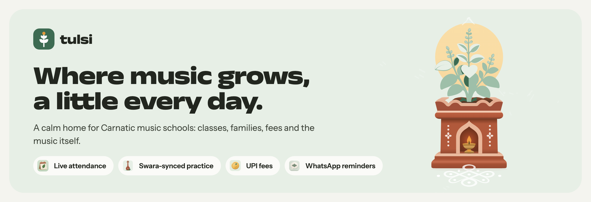
</p>

<p align="center">
  <a href="#a-home-for-everyone-in-the-school"><b>Features</b></a>
  &nbsp;·&nbsp;
  <a href="#music-at-the-centre"><b>The music</b></a>
  &nbsp;·&nbsp;
  <a href="#run-it-locally"><b>Run it locally</b></a>
  &nbsp;·&nbsp;
  <a href="#how-its-built"><b>How it's built</b></a>
  &nbsp;·&nbsp;
  <a href="docs/deployment.md"><b>Deploy</b></a>
</p>

<p align="center">
  
  
  
  
  
</p>

<br>

> In many homes the day begins at the tulsi: a little water, a lamp, a moment of care. Riyaz grows the same way.

**Tulsi** is a workspace for Carnatic music schools. The office runs classes, attendance, families and fees from one calm place. Teachers take attendance in a tap and leave feedback at the exact moment in a recording it's about. Families see what they owe and what's next. Learners practise with swara notation, a tanpura and a tala that keep time with them.

<p align="center">
  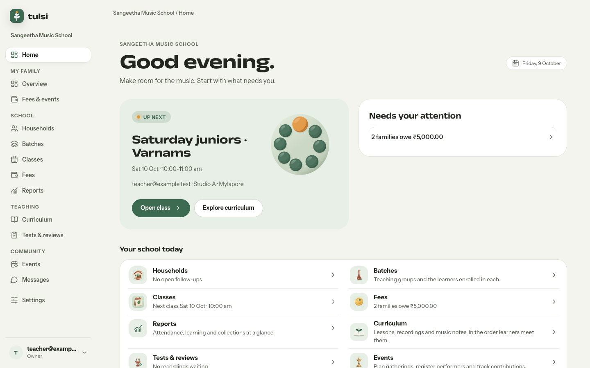
  <br>
  <sub>The owner's home starts with what needs them: the next class, families who owe fees, and a live line for every area of the school.</sub>
</p>

## A home for everyone in the school

Everyone signs in to the same school, and each person's home is shaped around their job.

<table>
  <tr>
    <td width="50%" valign="top">
      <h3>&nbsp; The office</h3>
      <ul>
        <li>A home that starts with what needs you: fees owed, payments to verify, classes without attendance, recordings to review.</li>
        <li>Households, batches and a class calendar that opens on this week.</li>
        <li>Fees with charges, fee plans and monthly billing, statements and receipts.</li>
        <li>Notices to families, with WhatsApp delivery and Razorpay payment links once they're set up.</li>
        <li>Reports on attendance, learning and collections.</li>
        <li>One <i>People</i> area to invite administrators, teachers, reviewers and families, each with an explicit role.</li>
      </ul>
    </td>
    <td width="50%" valign="top">
      <h3>&nbsp; Teachers and reviewers</h3>
      <ul>
        <li>A <i>Teaching</i> home with today's class and a <i>Take attendance</i> button.</li>
        <li>One-tap attendance: Present, Late, Absent or Excused, with <i>Mark the rest present</i> and lesson notes.</li>
        <li>Lessons to teach from, with swara notation, reference recordings and music notes.</li>
        <li>Recording reviews: pin a note to a moment or a passage, add a <i>Try this</i> exercise and rubric scores, then publish when it's ready.</li>
      </ul>
    </td>
  </tr>
  <tr>
    <td width="50%" valign="top">
      <h3>&nbsp; Families</h3>
      <ul>
        <li>What you owe, with <i>Report a payment</i> for UPI or bank transfers that the office then checks.</li>
        <li>Each child's classes in your own time zone, their practice and their teacher's feedback.</li>
        <li>Statements, receipts and school events in one place.</li>
        <li>A clear choice about whether a child's recordings and feedback may be used to build a music dataset.</li>
      </ul>
    </td>
    <td width="50%" valign="top">
      <h3>&nbsp; Learners</h3>
      <ul>
        <li>Lessons with a player that highlights each swara as it sounds.</li>
        <li>A practice room with a tanpura and the lesson's tala.</li>
        <li><i>I practised today</i> grows your own tulsi, from a sprout to a flowering manjari.</li>
        <li>Record and submit assignments, then read your teacher's notes at the moment they're about.</li>
      </ul>
    </td>
  </tr>
</table>

<table>
  <tr>
    <td width="50%">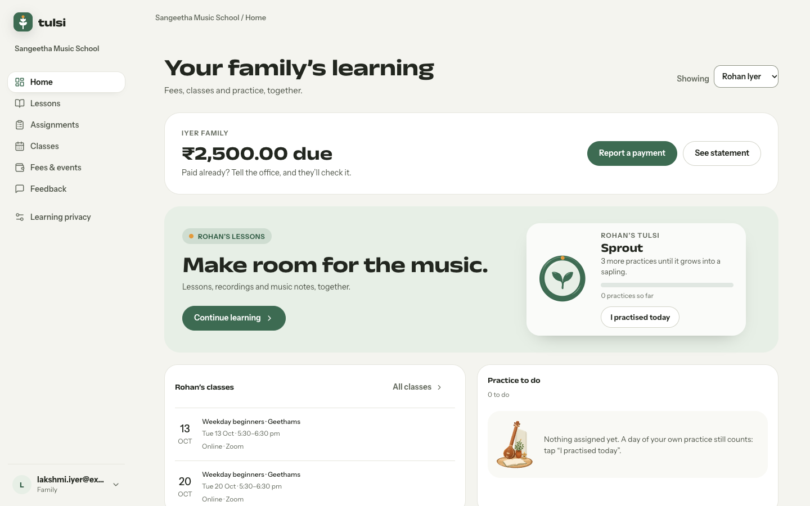</td>
    <td width="50%">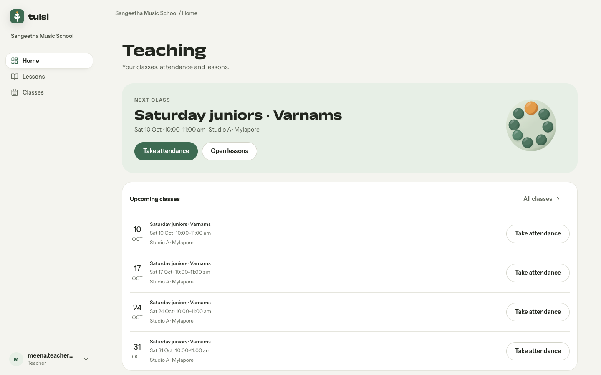</td>
  </tr>
  <tr>
    <td align="center"><sub>Families see what they owe, what's next and what to practise.</sub></td>
    <td align="center"><sub>Teachers start from today's class.</sub></td>
  </tr>
  <tr>
    <td width="50%">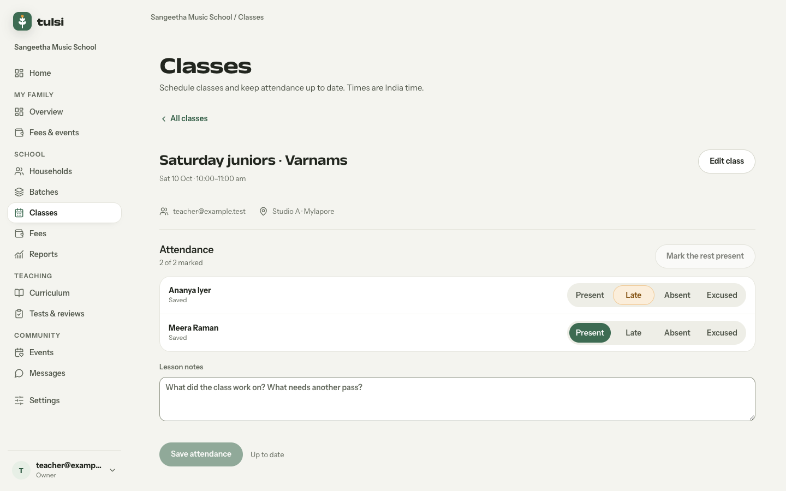</td>
    <td width="50%">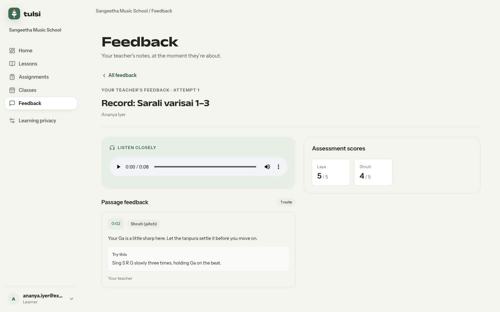</td>
  </tr>
  <tr>
    <td align="center"><sub>Attendance in one tap per learner.</sub></td>
    <td align="center"><sub>Feedback pinned to the moment in the recording.</sub></td>
  </tr>
</table>

## Music at the centre

<p align="center">
  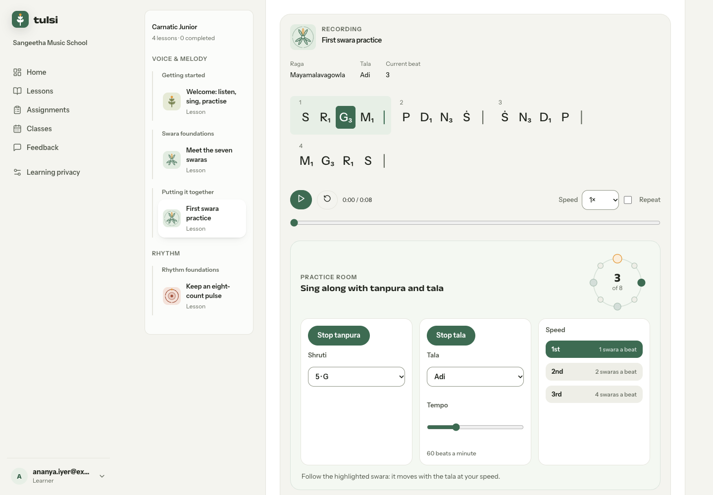
  <br>
  <sub>The practice room keeping Adi tala: the ring follows the beat, and the swara to sing lights up in the notation.</sub>
</p>

- **Swara notation** with octave dots, variant subscripts (R₁, G₃, D₁, N₃) and bar lines, highlighted in time with the recording.
- **Raga and tala up front**, with a cover for each raga and a ring for each tala.
- **A practice room**, made with Web Audio, with nothing to download:
  - a tanpura at the learner's shruti, chosen in kattai (1 is C, 5 is G). Its first string is tuned to Pa, or to Ma for ragas without Pa;
  - the lesson's tala (Adi, Rupaka, Misra Chapu or Khanda Chapu), with a deeper knock on the sam and a ring that follows each beat;
  - first, second or third speed, at 1, 2 or 4 swaras a beat, with the notation keeping pace.
- **Feedback at the moment it's about.** Reviewers pin notes to a point or a passage, suggest an exercise and score a rubric (for example shruti and laya), then publish it to the learner and their family.
- **An annotated dataset, with consent.** Verified listening notes can be exported as labelled Carnatic singing, only for learners whose families have opted in.

<p align="center">
  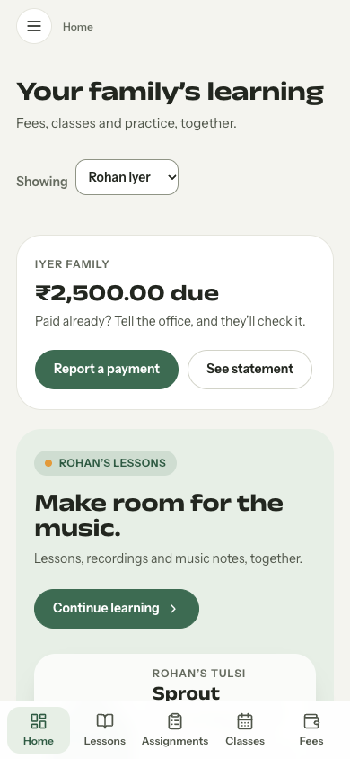
  &nbsp;
  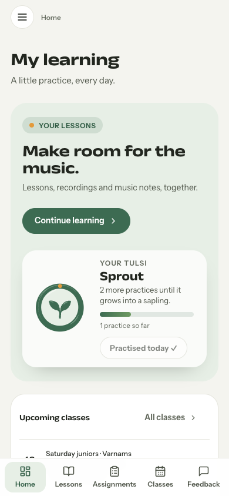
  &nbsp;
  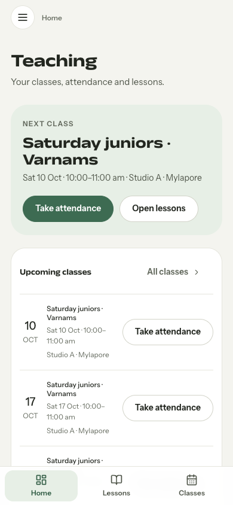
  <br>
  <sub>Made for phones, too: families, learners and teachers each get a tab bar of their own.</sub>
</p>

## Run it locally

You need Node.js 22.12 or later (24 is recommended). There's no database to install: local development uses [PGlite](https://pglite.dev), PostgreSQL compiled to WebAssembly, stored in `.data/`.

```sh
npm ci
cp .env.example .env
npm run dev
```

Open **http://127.0.0.1:5173** (use `127.0.0.1` rather than `localhost`, which the API rejects as a different origin).

Sign in as `teacher@example.test`, the seeded school owner. Local sign-in is a clearly labelled simulator: it shows a one-time code on screen, never authenticates with Google or sends an SMS, and the server refuses to start with it in production.

To add the **Carnatic Junior** demo curriculum (four lessons with audio, video, notation and music notes), stop `npm run dev` first, because PGlite allows one process at a time. Then run:

```sh
npx tsx scripts/seed-carnatic-junior.ts
```

### Everyday commands

| Command | What it does |
| --- | --- |
| `npm run dev` | Runs the API and the web app together, with the local sign-in simulator |
| `npm run check` | Type-checks the whole project |
| `npm test` | Runs the unit and integration tests (Vitest) |
| `npm run test:e2e` | Builds, then runs the end-to-end HTTP suite against its own database |
| `npm run build` | Builds the API and the web app for production |
| `npm start` | Serves the production build |
| `npm run db:migrate` | Applies the SQL migrations to `DATABASE_URL` |
| `npm run provision` | Creates a school and a seven-day invitation for its owner |
| `npm run backup` | Writes or restores a database backup |
| `npm run worker` | Sends scheduled reminders and notices (production only) |

For example, to open a new school and keep a backup:

```sh
npm run provision -- "My Music School" email owner@example.com my-music-school
npm run backup -- create /absolute/path/backup.json
npm run backup -- restore /absolute/path/backup.json
```

## How it's built

- **Web:** a React 19 single-page app built with Vite. The Tulsi design layer lives in `src/web/tulsi.css`, on top of shared tokens in `design-system.css`.
- **API:** NestJS on Fastify. It serves the built app, runs migrations when it starts, and keeps sessions in PostgreSQL.
- **Data:** PostgreSQL in production and PGlite locally, with plain SQL migrations in `migrations/`.
- **Schools:** each school has its own subdomain. Sessions are bound to the school, roles are explicit, and families only ever see their own learners.
- **Sign-in:** OpenID Connect through FusionAuth (or another compatible provider) for Google and phone codes, plus the local simulator for development.
- **Media:** recordings and lesson files stay private, on a persistent disk or a private S3 bucket and never a public one, with a quota per school.
- **Integrations:** WhatsApp Cloud API for notices and Razorpay for payment links. Credentials stay on the server.

```text
src/
  web/          React app: school workspace, family and learner portal, settings
    components/ music player, practice room, page header, artwork
    features/   one folder per area (school, auth, settings)
    lib/        dates, the practice maths and its Web Audio engine
  server/       NestJS API: identity, tenancy, schools, billing, schedule, learning
  shared/       swara cue timing for the lesson player
  core/         access rules, account names and CSV helpers used by the web app and the API
migrations/     SQL migrations, applied in order
scripts/        dev runner, migrations, provisioning, backup, worker, demo seed, e2e suite
public/         the Tulsi mark and illustrations
demo/           media for the Carnatic Junior demo curriculum
tests/          Vitest suites
docs/           deployment notes and README images
```

## Design

<p align="center">
  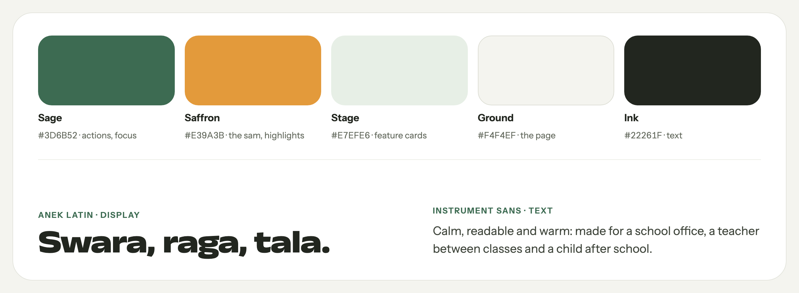
</p>

Tulsi is meant to feel like a courtyard rather than a dashboard:

- **A plant runs through it.** Illustrations of the tulsi, its courtyard and its growth carry the empty states and celebrate progress.
- **Calm motion.** Animations play a few times and then rest, and reduced-motion settings are always respected.
- **Accessible by default.** Every control shows a 2px focus outline and can be reached from the keyboard, no text is smaller than 12px, and colours meet contrast targets.
- **Words for people.** Families read "Paid" and "October 2026 tuition", not system states, and times show in their own time zone.

## Deploying

Build with Node.js 24 and run `NODE_ENV=production npm start` behind an HTTPS reverse proxy. Set `DATABASE_URL`, apply migrations with `npm run db:migrate`, and provision each school's first owner with the CLI. The [deployment notes](docs/deployment.md) cover the runtime, school subdomains, sign-in through FusionAuth or another OIDC provider, and release checks. Never set `AUTH_MODE=local` in production: the server refuses to start with it.

## Licence

Tulsi is released under the [Apache License 2.0](LICENSE).

<br>

<p align="center">
  
  <br>
  <sub>Where music grows, a little every day.</sub>
</p>
